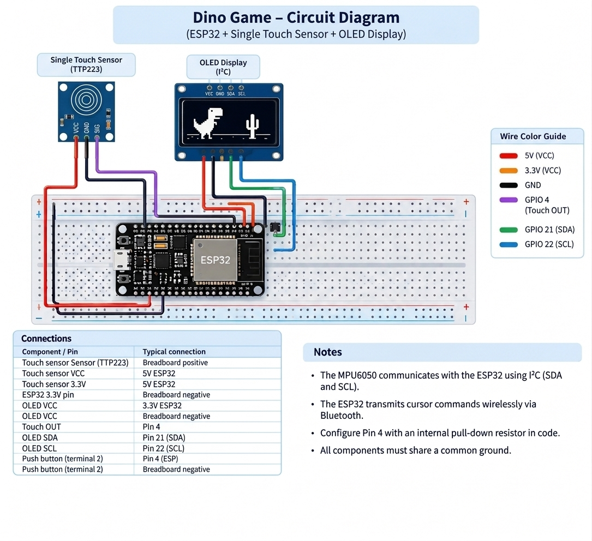

# Dino Game

## Aim
To create a simple dinosaur-style game controlled by a touch sensor and displayed on an OLED screen.

## What is the project?
A small embedded game in which the player uses a touch input to control a character and avoid obstacles on the screen.

## How does it work?
1. The single touch sensor detects when the user touches it.
2. The ESP32 interprets the signal as a game input, such as a jump command.
3. The program updates the dinosaur's position and the movement of obstacles.
4. The ESP32 draws the updated game scene on the OLED display.
5. The program checks for collisions and updates the score or game-over state if these features are included.

## Components used
- ESP32 microcontroller
- Single capacitive touch sensor
- OLED display
- Breadboard
- Jumper wires

## Circuit Diagram

## Connections
| Component / Pin | Typical connection |
|---|---|
| Touch sensor VCC | 5V (ESP32) |
| Touch sensor GND | GND (ESP32) |
| Touch sensor OUT | Pin 4 (ESP32) |
| OLED VCC | 3.3V (ESP32) |
| OLED GND | GND (ESP32) |
| OLED SDA | Pin 21 (ESP32) |
| OLED SCL | Pin 22 (ESP32) |

## Important wiring notes
- Check the touch sensor's supply and output-voltage specifications before connecting it to the ESP32.
- The source specifies OLED VCC at 3.3V and GND at ESP32 GND.
- The diagram is an illustrative reference; verify actual module pin labels before powering the circuit.
